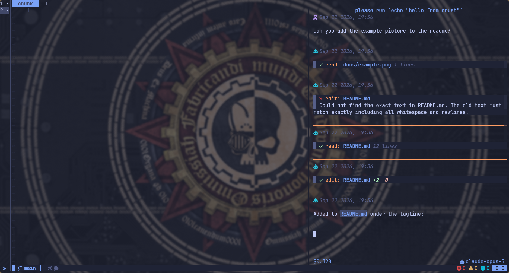

# crust.nvim

> [!WARNING]
> Early work in progress. API and commands may change.

A Neovim front-end for [PI](https://pi.dev)



## Claude plan usage

`:Crust usage` (or `require("crust").usage()`) shows what is left of the
Claude subscription pi is logged into — the same figures as Claude Code's
`/usage`:

```
Claude plan usage
  5-hour session       ████░░░░░░░░░░░░░░░░   21%  (resets in 3h 12m)
  Weekly (all models)  ███████████░░░░░░░░░   54%  (resets in 2d 4h)
  Weekly (Opus)        ████████████████░░░░   83%  (resets in 1d)  [high]
  Weekly breakdown: Sonnet 40%, Opus 14%
```

`r` refetches (`:Crust usage refresh` does the same), `q`/`<Esc>` closes.
The numbers come from the oauth usage endpoint with a token from
`pi auth print-bearer-token --provider anthropic`; they are cached for 60s
because the endpoint is rate limited, and a failed request keeps showing the
last answer with a note.

The prompt bar carries the short form whenever an **anthropic** model is
selected:

```
󰾆 5h 21% · wk 54%                                       󰚩 claude-opus-4-6
```

It is the `usage` input-bar component, orange from 50% and red from 80%.
Swap it for the per-session dollars with
`input_bar = { layout = { left = { "cost" } } }`.

## Debugging

`:Crust debug` (or `require("crust").debug()`) opens the raw rpc of every
live pi process in a new tab: the command each was spawned with, every line
sent, every line received, everything pi wrote to **stderr** — where provider
and auth failures actually say what went wrong — and the exit code.

```
09:05:11.412 $ pi --mode rpc  (cwd: /home/me/project)
09:05:11.430 > {"type":"prompt","id":"crust:2",…}
09:05:11.930 < {"type":"agent_start",…}
09:05:12.004 ! Error: OAuth refresh failed for anthropic: …
09:05:12.010 x pi exited with 1
```

Recording is always on and in memory, so a failure can be read after the
fact. `:Crust debug pretty` expands the json; `debug = { history = 2000 }`
caps how far back it goes, and `log = { enabled = true }` still writes the
same traffic to disk per session.

## Permission prompts

An extension that needs a decision — [pi-permission-system](https://pi.dev/packages/pi-permission-system)
above all — calls `ui.select`, `ui.confirm`, `ui.input` or `ui.editor`. pi
forwards each of those as an `extension_ui_request` and **blocks the agent**
until the answer comes back, so crust draws every one of them as a floating
dialog and always answers:

```
╭────────────────────── select ───────────────────────╮
│ Current agent requested tool 'bash'. Allow this call?│
│ rm -rf /tmp/scratch                                  │
│                                                      │
│  1  Yes                                              │
│  2  Yes, for this session                            │
│  3  No                                               │
│  4  No, provide reason                               │
╰──── <CR> choose · 1-9 pick · q cancel ───────────────╯
```

- `<CR>` picks the option under the cursor, `1`-`9` pick directly.
- `q` / `<Esc>` dismiss, which the extension reads as a refusal.
- Text dialogs (`input`, `editor`) show the question above the editable line;
  `<CR>` submits a one-liner, `<C-s>` submits either, `q` cancels.
- One dialog is on screen at a time; the rest queue up and open as soon as the
  current one is answered.
- `notify` requests become `vim.notify`; the other fire-and-forget methods are
  ignored.

```lua
require("crust").setup({
    ask = {
        enabled = true, -- false refuses every request instead of asking
        notify = true,  -- extension notifications as vim.notify
    },
})
```

Turning `ask.enabled` off still answers each request — as cancelled — because
a dropped request leaves the turn hanging forever.

## Requirements

- Neovim >= 0.13
- [snacks.nvim](https://github.com/folke/snacks.nvim) (optional, session picker with delete)
- [blink.cmp](https://github.com/Saghen/blink.cmp) (optional, popup completion in the chat input)
- [plenary.nvim](https://github.com/nvim-lua/plenary.nvim) (tests only)
